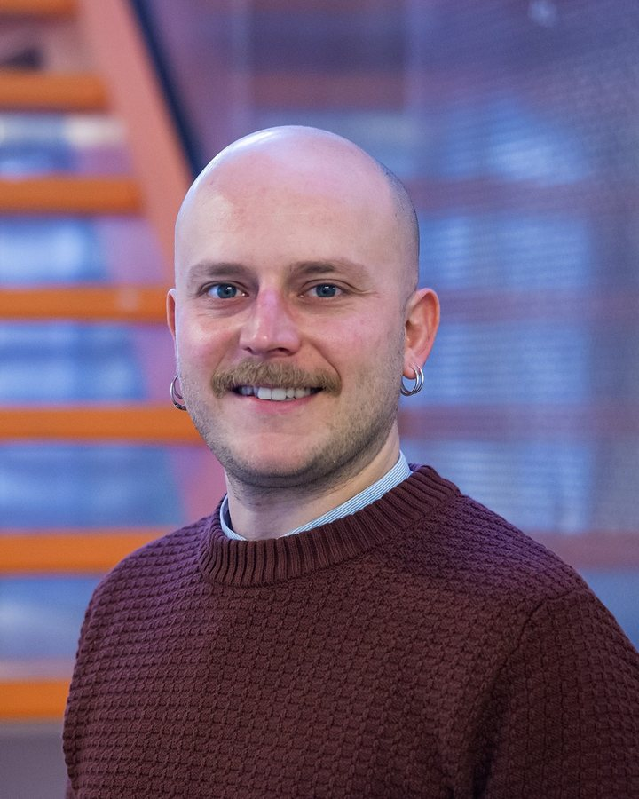

::: {.hero .column-body-outset}

::: {.hero-photo}
{fig-alt="Portrait of Bernardo Caldarola"}
:::

::: {.hero-text}
# Bernardo Caldarola {.hero-name}

[Economic Complexity Analyst at the European Commission's Joint Research Centre in Seville, and affiliated researcher at UNU-MERIT]{.hero-role}

I am an applied economist working where development economics meets the economics of innovation. I study how economies build new capabilities and change what they produce, and what this means for firms, workers and regions.

My research follows three connected lines: the drivers of structural transformation and its distributional and environmental consequences; the adoption of digital technologies, from mobile internet to cloud computing, and their effects on firms, skills and jobs; and economic complexity methods applied to EU industrial and technology policy. I have also worked on how teleworking changes the way people travel.

I work in the Economic Complexity Team of the JRC's Industrial Strategy, Skills and Technology Transfer unit. Before joining the JRC, I was a research fellow at UNU-MERIT in Maastricht and at the Enrico Fermi Research Centre in Rome. I hold a PhD in Science and Technology Policy Studies from SPRU, University of Sussex.

```{=html}
<ul class="hero-links">
  <li><a href="mailto:bernardo.caldarola@gmail.com"><i class="bi bi-envelope" aria-hidden="true"></i>Email</a></li>
  <li><a href="https://scholar.google.com/citations?user=R3LlB_cAAAAJ&hl=en"><i class="bi bi-mortarboard" aria-hidden="true"></i>Google Scholar</a></li>
  <li><a href="https://www.linkedin.com/in/bernardo-caldarola/"><i class="bi bi-linkedin" aria-hidden="true"></i>LinkedIn</a></li>
  <li><a href="https://github.com/bernacalda"><i class="bi bi-github" aria-hidden="true"></i>GitHub</a></li>
  <li><a href="files/cv_BC.pdf"><i class="bi bi-file-earmark-text" aria-hidden="true"></i>CV (PDF)</a></li>
</ul>
```
:::

:::

::: {.facts .column-body-outset}

::: {}
## Research interests

- Structural change and development
- Economics of innovation
- Economic complexity
- Skills and labour markets
- Regional and industrial policy
:::

::: {}
## Education

- PhD in Science and Technology Policy Studies, 2023 [SPRU, University of Sussex]{.fact-sub}
- MSc in Development and International Cooperation, 2016 [ISEG, University of Lisbon]{.fact-sub}
- BA in Political Science and International Relations, 2013 [University of Pavia]{.fact-sub}
:::

::: {}
## Latest

<!-- The three newest items from data/news.yml appear here automatically. -->
::: {#news-latest}
:::

[All news →](news.qmd){.facts-more}
:::

:::
